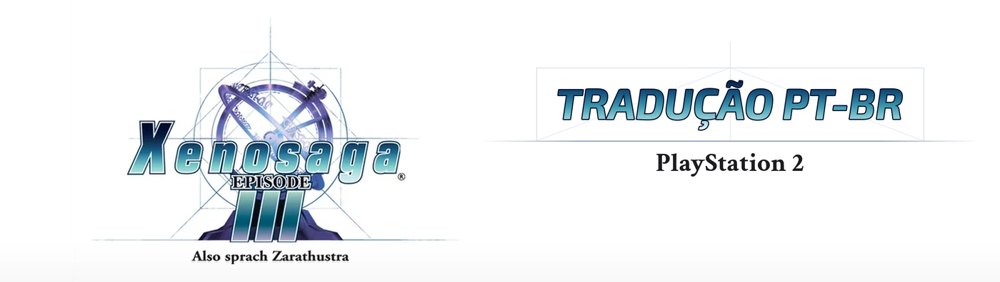
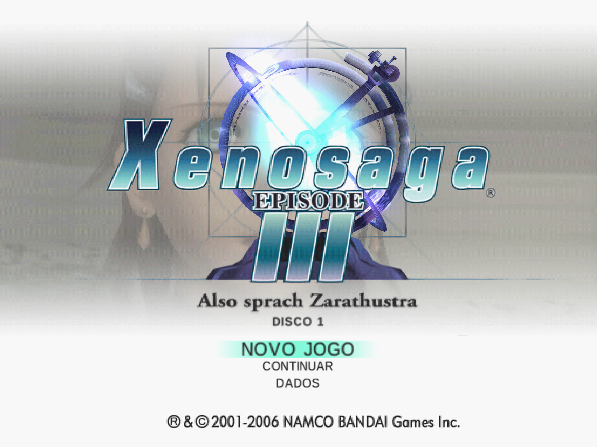
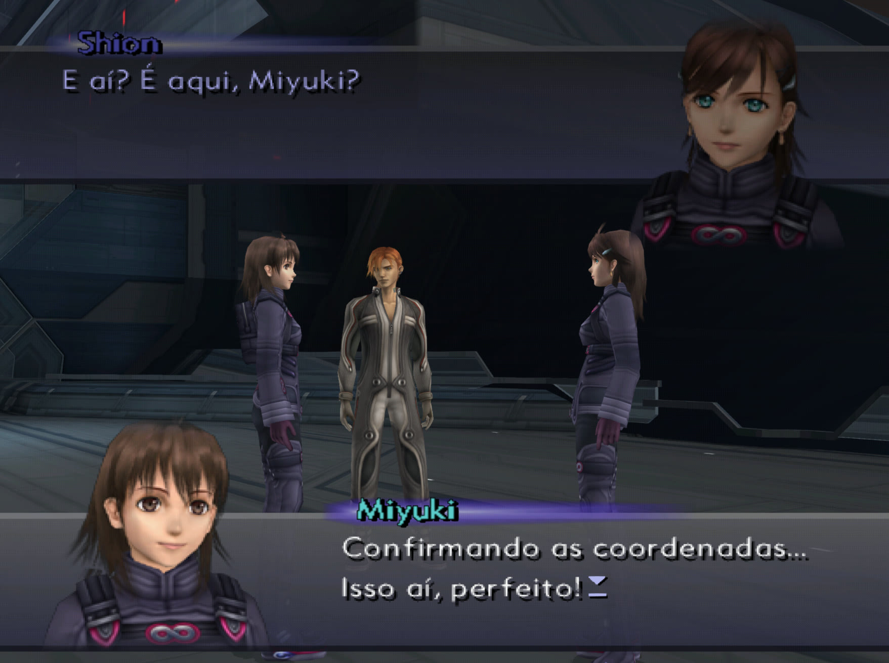
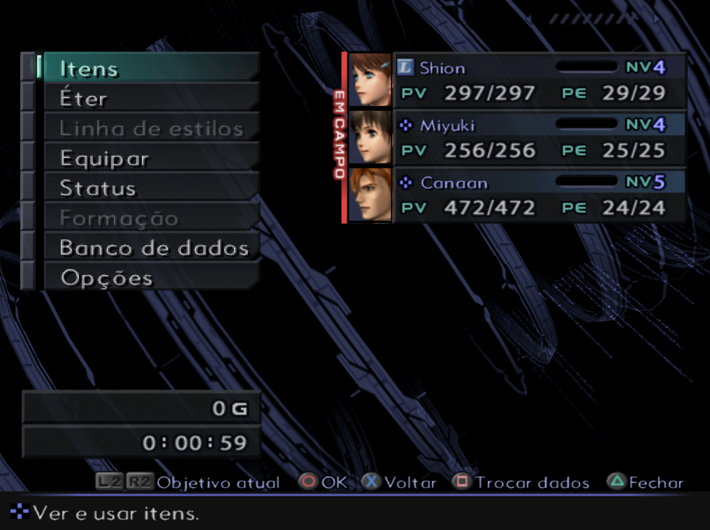
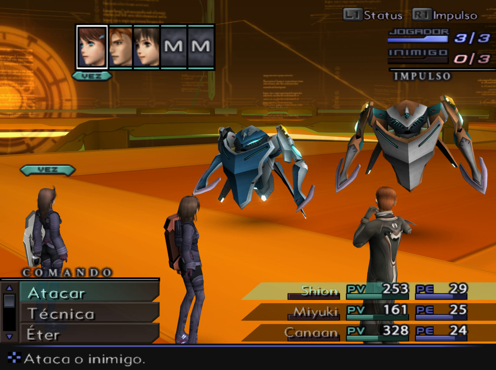

# 🌌 Xenosaga Episode III: Also sprach Zarathustra (PS2) — Tradução PT-BR

-009c3b)

-555)


Tradução de fã do **Xenosaga Episode III: Also sprach Zarathustra** (PlayStation 2, versão americana), nos **dois
discos**. **Tradução completa para o português do Brasil**, com menus, história, diálogos, legendas das cenas, golpes,
técnicas, itens, inimigos, o **Banco de dados** inteiro e imagens com texto em português.

*Feita por fãs, para fãs. Gratuita, sem fins lucrativos e sem nenhuma ligação com a Bandai Namco ou a Monolith Soft
(veja o aviso legal no fim desta página).*

> ✅ O jogo inteiro está traduzido, nos dois discos. Se achar algum problema, abra uma [issue](../../issues).

## 🖼️ Imagens

| | |
|---|---|
|  |  |
| Tela de título | Conversa entre a Shion e a Miyuki |
|  |  |
| Menu principal | Batalha |

## 📥 Download

**[⬇️ Baixar a tradução](../../releases/latest)** (página da versão mais recente). Dentro do zip vêm os patches xdelta dos
dois discos e um guia `LEIA-ME.txt`. Como instalar: veja **💾 Instalação** abaixo.

## 🎮 O que foi traduzido

| Parte | Textos | Cobertura |
|---|---|---|
| Diálogos, cenas e conversas no mapa | 13.618 | 100% |
| Legendas das cenas e das vozes de batalha | 2.887 | 100% |
| Banco de dados (fichas, resumos da história, termos) | 3.297 | 100% |
| Menus, itens, habilidades, técnicas, inimigos, tutoriais e sistema | 5.520 | 100% |
| Sinopses ("A história até aqui") | 451 | 100% |
| Imagens com texto (título, rótulos da batalha, perfis, letreiros de lugares, avisos) | mais de 40 texturas | as que cabem em português |

*Contagem de textos diferentes. Muitos aparecem nos dois discos e em vários lugares do jogo.*

- **Contexto da história:** cada fala foi traduzida e revisada sabendo em que ponto da história está, quem fala com
  quem e o que cada personagem já sabe, com o texto japonês ao lado para conferir gênero, tratamento e sentido.
- **Cada personagem fala do seu jeito:** a Shion é direta e se cobra demais, o Allen é inseguro e atrapalhado, o Jr. é
  esquentado e brincalhão, a KOS-MOS é fria e precisa, a MOMO é educada e gentil, o Ziggy é seco e militar.
- **Acentos e cedilha** na fonte do jogo, inclusive nos rótulos em letra estilizada e nos textos que sobem na tela
  durante a batalha.
- **Medidas no lugar:** a largura de cada caixa foi medida com a tabela de letras do próprio jogo, para o texto caber
  sem cortar.
- **Glossário único:** o mesmo termo tem o mesmo nome nas falas, nos menus, nos itens e no Banco de dados.
- **Jogo original intacto:** o executável do jogo não foi alterado, então o PCSX2 e o RetroAchievements reconhecem o
  jogo normalmente.

### Alguns exemplos

- **Interface:** PV/PE no lugar de HP/EP, PH para os pontos de habilidade, Impulso (Boost), Quebra (Break), Golpe
  especial.
- **Termos do mundo:** *Federation → Federação · Realian → Realiano · Abel's Ark → Arca de Abel · Song of Nephilim →
  Canção de Nephilim · Segment File → Arquivo de segmentos*.
- **Nomes próprios ficam:** personagens, naves (Elsa, Durandal), lugares como Labyrinthos e termos como Zohar, Gnosis e
  E.S.

## 🚫 O que não foi traduzido (de propósito)

| O quê | Por quê |
|---|---|
| Nomes de personagens, naves e organizações com nome próprio | São nomes próprios, iguais em todas as versões do jogo. |
| Vozes e dublagem | Ficam as vozes originais em inglês. As legendas estão em português. |
| Créditos finais | Ficam como no original. |
| Placas e avisos desenhados nos cenários 3D (WARNING, EXIT…) | Fazem parte da arte dos cenários. |
| Logotipos e copyright | Marcas registradas. |
| Siglas desenhadas dentro de ícones | Ficam como no original. O texto do jogo explica cada uma. |

Se encontrar outra coisa em inglês, abra uma issue.

## 💿 O que você precisa

Você precisa das suas **próprias ISOs** da versão americana (NTSC-U). **Este projeto não distribui o jogo.**

| Disco | Arquivo esperado | Tamanho (bytes) | CRC32 | SHA-1 |
|---|---|---|---|---|
| 1 | Xenosaga Episode III - Also sprach Zarathustra (USA) (Disc 1).iso | 3923804160 | `cfd0d722` | `30a887e6942cef57099bc9c84de5b39974e62f9a` |
| 2 | Xenosaga Episode III - Also sprach Zarathustra (USA) (Disc 2).iso | 4515954688 | `1855b442` | `9902a798f2f4a7d7a4af6078ec3e5ec5107d5450` |

## 💾 Instalação

1. Baixe o zip na página de [Releases](../../releases) e descompacte.
2. **Faça uma cópia** das suas ISOs originais.
3. Aplique o patch de cada disco:
   - **🪟 Windows:** abra o [Delta Patcher](https://github.com/marco-calautti/DeltaPatcher). Em *Original file*,
     escolha a **cópia** da ISO; em *XDelta patch*, o `.xdelta` do mesmo disco. Depois clique em *Apply patch*.
     O Delta Patcher grava o resultado **por cima** do arquivo escolhido, por isso use a cópia.
   - **🐧 Linux/macOS:**
     ```
     xdelta3 -d -s "Xenosaga Episode III - Also sprach Zarathustra (USA) (Disc 1).iso" XS3_PTBR_Disco1.xdelta XS3_PTBR_Disco1.iso
     xdelta3 -d -s "Xenosaga Episode III - Also sprach Zarathustra (USA) (Disc 2).iso" XS3_PTBR_Disco2.xdelta XS3_PTBR_Disco2.iso
     ```
4. (Opcional) Confira a ISO traduzida com os códigos do `LEIA-ME.txt`.
5. Abra a ISO traduzida no emulador (PCSX2, por exemplo) ou no console. Saves do jogo em inglês funcionam normalmente.

**Para atualizar** a partir de uma versão anterior, aplique o patch novo numa nova cópia das ISOs **originais** (o patch é
sempre aplicado na ISO original, nunca numa ISO já traduzida). **Para voltar ao inglês**, use a ISO original.

## 🔒 Segurança

- Baixe os patches **só pela página de [Releases](../../releases) deste repositório**.
- Confira os patches com o `SHA256SUMS.txt` do pacote (Windows: `certutil -hashfile XS3_PTBR_Disco1.xdelta SHA256`;
  Linux/macOS: `sha256sum -c SHA256SUMS.txt`).
- Faça backup do seu cartão de memória antes de jogar (no PCSX2, o `Mcd001.ps2` da pasta `memcards`).

## ❓ Não funcionou?

| Sintoma | Causa provável |
|---|---|
| O Delta Patcher dá erro de checksum ou "source file" | A ISO não é a americana original 1:1 (ou já foi traduzida antes). Confira o CRC32/SHA-1 da tabela acima. |
| Textos misturados (parte em inglês, parte em português) depois de atualizar | Você carregou um *save state* feito com a versão anterior. Reinicie o jogo e continue pelo save do cartão de memória. |
| O disco 2 não é aceito na troca de disco | Aplique o patch do disco 2 na ISO do **disco 2**, da mesma versão do patch usada no disco 1. |
| Tela preta ou travamento | Abra uma issue informando onde aconteceu. |

## 🐞 Achou um erro?

Abra uma [issue](../../issues/new/choose) usando o formulário "Erro na tradução". Informe a versão do patch, o disco, o
lugar do jogo e, se puder, mande um print. Toda correção de português também é bem-vinda.

## 🙏 Créditos

- **Tradução, revisão e ferramentas:** [0xdhx0](https://github.com/0xdhx0).
- **Fontes livres (licença OFL)** usadas nas imagens: BIZ UDMincho e BIZ UDGothic.

**Como foi feita:** a tradução usou ferramentas de IA. Todos os diálogos foram revisados com o contexto da história, o
texto japonês e o jeito de falar de cada personagem, medidos para caber nas caixas e testados no PCSX2. Se achar uma
frase estranha, abra uma [issue](../../issues), porque toda sugestão ajuda.

## ⚖️ Aviso legal e uso

- Esta é uma **tradução feita por fãs, para fãs**, **gratuita** e **sem fins lucrativos**.
- **Não temos nenhuma ligação** com a Bandai Namco, a Monolith Soft ou qualquer outra empresa envolvida no jogo. O
  projeto não é oficial, nem aprovado ou apoiado por elas.
- *Xenosaga Episode III: Also sprach Zarathustra* e todos os nomes, marcas e personagens pertencem aos seus donos
  (© Bandai Namco Entertainment / Monolith Soft).
- O patch contém **apenas as diferenças** em relação ao jogo original e **não funciona sem uma cópia do jogo**. Nenhum
  arquivo do jogo é distribuído aqui. Não peça nem compartilhe ISOs neste repositório.
- Pode usar e compartilhar o patch à vontade, **de graça**. Ele **não pode ser vendido** nem monetizado. Se alguém
  cobrou por ele, você foi enganado. Veja [LICENSE.txt](LICENSE.txt).
- Se você é detentor de algum direito e quer que algo seja retirado, abra uma issue ou entre em contato pelo GitHub.

Apoie a franquia comprando os jogos oficiais.
